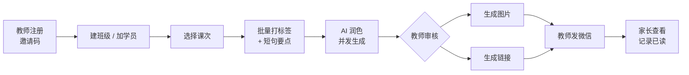
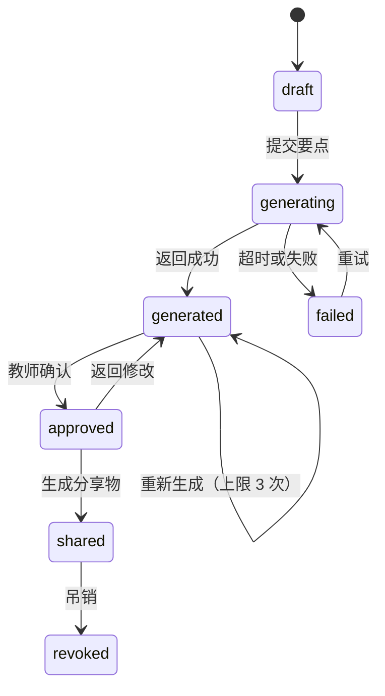

# 课后反馈模块需求

教师录入标签与要点，平台生成可发送给家长的反馈，支持批量处理与分享。

- **类型**：项目需求
- **目标读者**：产品与开发者本人；后续参与实现的人或 AI 代理。
- **覆盖范围**：模块范围、核心主链路、领域模型、反馈状态机、标签体系、质量闸门、移动端与分享。
- **不覆盖范围**：租户、权益、管理端、合规与里程碑见 [平台需求](../platform/requirements.md)；prompt 实现见 [Prompt 设计](../../design/feedback/prompt.md)。
- **相关文档**：[数据库设计](../../design/platform/database.md)、[API 契约](../../design/platform/api-contract.md)、[认证与安全](../../design/platform/authentication.md)。
- **状态**：v0.1，已确认需求，待实现。

## 1. 模块范围

### 1.1 v1 范围

| 模块 | 内容 |
| --- | --- |
| 学员与班级 | 学员（最小字段）、班级、课次 |
| 反馈录入 | 按课次批量打标签、填写短句要点 |
| 反馈生成 | AI 润色（流式）、模板生成（无 AI） |
| 审核 | 草稿编辑、重新生成、确认 |
| 分享 | 图片、一次性链接、已读回执、吊销 |

### 1.2 明确不做

- 课件资源市场（含上传、付费下载、平台抽成）。
- 趋势图表与语音反馈（数据结构预留，界面不做）。
- 自动发送：必须由教师确认后才产生分享物。

## 2. 核心主链路

验收标准：

1. 新教师从注册到完成第一次分享，不超过 10 分钟。
2. 一个 15 人班级的课次反馈，从录入到全部生成完成不超过 10 分钟。
3. 家长在微信内打开链接无需登录，7 天内有效。

## 3. 领域模型

平台实体、权益与审计表见 [数据库设计](../../design/platform/database.md) 第 2、3 节；平台规则见 [平台需求](../platform/requirements.md)。模块表一律带 `tenant_id`。

| 实体 | 关键字段 | 约束 |
| --- | --- | --- |
| `Student` | `tenant_id`、`name`、`grade`、`subject?`、`archived_at` | 仅存必要字段，禁止存证件号、住址、家长联系方式 |
| `Class` | `tenant_id`、`name`、`subject` | 属于租户 |
| `Lesson` | `tenant_id`、`class_id`、`date`、`topic`、`status` | 录入的组织单位，不是学生；不叫 `Session`，避免与认证会话撞名 |
| `Feedback` | `lesson_id`、`student_id`、`notes`、`ratings`、`knowledge_tags`、`homework`、`rendered`、`status`、`generated_by`、`regen_count` | `notes` 为教师原始要点，AI 不可覆盖 |
| `FeedbackTemplate` | `tenant_id?`、`name`、`tag_preset`、`body` | `tenant_id` 为空表示平台内置 |
| `ShareArtifact` | `feedback_id`、`type`、`token_hash`、`expires_at`、`revoked_at`、`first_viewed_at` | 只存 token 哈希，不存明文 |

### 3.1 反馈状态机

`generated_by` 取值为 `ai` 或 `template`，用于区分配额计费与质量统计。

## 4. 标签与反馈生成

标签体系是产品的垂直价值载体。每个标签带有语气权重（正面、中性、待改进），用于约束 AI 措辞强度。

| 维度 | 标签 |
| --- | --- |
| 课堂表现 | 专注投入 / 积极参与 / 偶有走神 / 需督促 |
| 作业 | 按时完成 / 质量优秀 / 部分未完成 / 未提交 |
| 知识点 | 掌握扎实 / 基本掌握 / 存在薄弱点（附具体知识点） |
| 进步 | 明显进步 / 稳步提升 / 需加强 |
| 习惯 | 主动提问 / 需培养习惯 / 笔记规范 |
| 下步建议 | 教师自由填写一句 |

生成规则：

1. 教师未使用 AI 时，标签直接拼装为模板文本，功能完整可用。
2. AI 只能组织语言，不得引入教师输入中不存在的具体事实、数字或事件。
3. 输出进入可编辑草稿，教师确认后才产生分享物，禁止自动发送。
4. 重新生成不超过 3 次，且不额外扣减配额。
5. 分享物标识遵循平台合规要求，见 [平台需求](../platform/requirements.md) 第 8 节。

## 5. 质量闸门

AI 输出在落库前必须通过以下校验，任一不通过则返回失败状态并允许重试：

| 检查 | 规则 |
| --- | --- |
| 事实一致 | 输出中的人名、数字、专有名词必须能在教师输入中找到来源 |
| 长度 | 正文 80–200 字 |
| 结构 | 必须包含下步建议句 |
| 禁用词 | 不含绝对化用语、贬损词、承诺性表述 |
| 语气匹配 | 待改进类标签不得输出过度正向措辞 |

维护一份 30–50 条金标样本，任何 prompt 或模型变更都必须跑回归，通过率不得下降。具体约束与回归流程见 [Prompt 设计](../../design/feedback/prompt.md)。

## 6. 移动端与分享

教师主要在课后用手机录入，移动端是主形态。

| 约束 | 要求 |
| --- | --- |
| 布局 | 响应式：`< 768px` 单列、`>= 1024px` 双列；移动优先，但预留桌面布局 |
| 草稿 | 标签状态本地持久化，弱网不丢录入 |
| 默认值 | 打开学员时继承该学员上次使用的标签组合 |
| 生成 | 并发 3，显示进度；允许离开页面 |
| 图片 | 1080×1440 PNG，内置中文字体子集，不使用 emoji |
| 微信内 | 图片以页面元素展示并提示长按保存，不依赖 Blob 下载 |
| 链接 | 一次性 token，7 天过期，可吊销，记录首次查看时间 |

## 7. 与其他文档的关系

| 内容 | 位置 |
| --- | --- |
| 租户、权益、管理端、合规 | [平台需求](../platform/requirements.md) |
| Prompt 约束与回归 | [Prompt 设计](../../design/feedback/prompt.md) |
| 表结构与 RLS | [数据库设计](../../design/platform/database.md) |
| 端点与错误码 | [API 契约](../../design/platform/api-contract.md) |
| 页面与交互 | [前端架构](../../design/platform/frontend.md) |
