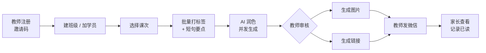
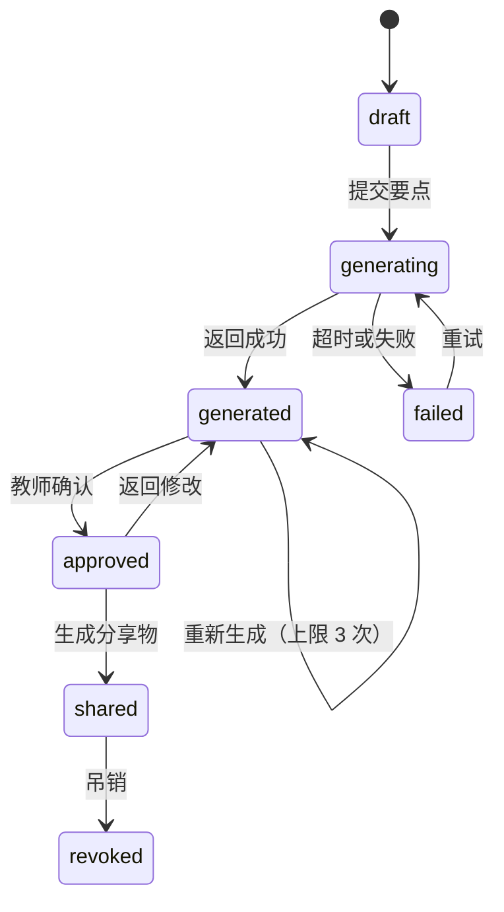

# 教培教师 AI 反馈平台需求说明

面向教培行业教师的课后反馈工具：教师录入标签与要点，平台生成可发送给家长的反馈，支持批量处理与分享。

- **目标读者**：产品与开发者本人；后续参与实现的人或 AI 代理。
- **覆盖范围**：v1 的业务范围、领域模型、核心链路、权益规则、管理端能力、非功能约束与合规要求。
- **不覆盖范围**：技术实现细节（目录结构、依赖选型）、部署脚本、UI 视觉规范。这些在对应 ADR 与代码中定义。
- **相关文档**：[数据库设计](../engineering/database.md)、[API 契约](../engineering/api-contract.md)、[认证与安全](../engineering/authentication.md)、[Prompt 与质量](prompt-design.md)。
- **状态**：v0.1，已确认需求，待实现；未确认项见第 15 节。

## 1. 背景与定位

教培老师在课后需要逐个向家长反馈学生学习情况，这是维系续费的核心动作，也是耗时的重复劳动。一个班级 10–20 名学生，逐条撰写反馈通常需要 1 小时以上。

本产品把这件事压缩为：**课后按课次批量打标签 → AI 润色 → 教师审核 → 生成图片或链接发微信**。

定位上有三个刻意选择：

| 选择 | 理由 |
| --- | --- |
| 面向教师个人，而非机构 | 机构客户会自建或采购整体方案，个人教师才是可自助转化的群体 |
| 面向教培，而非公立校 | 公立校走财政与集采，个人付费路径不成立 |
| 卖工作流，而非生成能力 | 单点「生成评语」已被通用工具和大模型直接覆盖，没有壁垒 |

## 2. 目标用户与角色

| 角色 | 说明 | 权限 |
| --- | --- | --- |
| 教师（租户所有者） | 主要用户，个人即一个租户 | 租户内全部操作 |
| 助教（租户成员） | 协助录入与分享，可选 | 录入、生成、分享；不能管理租户与权益 |
| 平台运营 | 内部人员 | 租户管理、权益开通、审计查看 |
| 家长 | 反馈的阅读者，**不是平台账号主体** | 通过一次性链接或图片查看，免登录 |

家长不注册、不登录、不产生账号，是刻意的设计：注册墙会让分享动作失败，而分享是整个产品的价值出口。

## 3. 范围

### 3.1 v1 范围

| 模块 | 内容 |
| --- | --- |
| 账号与租户 | 邀请码注册、登录、单租户自建、邀请助教 |
| 学员与班级 | 学员（最小字段）、班级、课次 |
| 反馈录入 | 按课次批量打标签、填写短句要点 |
| 反馈生成 | AI 润色（流式）、模板生成（无 AI） |
| 审核 | 草稿编辑、重新生成、确认 |
| 分享 | 图片、一次性链接、已读回执、吊销 |
| 权益 | 免费层、增值包、AI 份数配额、超限降级 |
| 管理端 | 租户列表与详情、权益开通、邀请码、审计日志 |

### 3.2 明确不做

- 课件资源市场（含上传、付费下载、平台抽成）。
- 在线支付（v1 由运营手动开通增值包）。
- 短信或服务号代发反馈。
- 家长端账号体系与家长 App。
- 趋势图表与语音反馈（数据结构预留，界面不做）。
- 组织层级（校区、部门）、多语言、移动原生 App。

## 4. 核心主链路

验收标准：

1. 新教师从注册到完成第一次分享，不超过 10 分钟。
2. 一个 15 人班级的课次反馈，从录入到全部生成完成不超过 10 分钟。
3. 家长在微信内打开链接无需登录，7 天内有效。

## 5. 领域模型

| 实体 | 关键字段 | 约束 |
| --- | --- | --- |
| `Tenant` | `name`、`slug`、`status`、`created_at` | 教师注册即创建，默认名「XX 老师的工作室」 |
| `User` | `email`、`phone?`、`password_hash`、`status` | 全局账号，可属于多个租户 |
| `Membership` | `tenant_id`、`user_id`、`role`、`status` | `(tenant_id, user_id)` 唯一；v1 使用 `owner`、`member` |
| `Student` | `tenant_id`、`name`、`grade`、`subject?`、`archived_at` | 仅存必要字段，禁止存证件号、住址、家长联系方式 |
| `Class` | `tenant_id`、`name`、`subject` | 属于租户 |
| `Lesson` | `tenant_id`、`class_id`、`date`、`topic`、`status` | 录入的组织单位，不是学生；不叫 `Session`，避免与认证会话撞名 |
| `Feedback` | `lesson_id`、`student_id`、`notes`、`ratings`、`knowledge_tags`、`homework`、`rendered`、`status`、`generated_by`、`regen_count` | `notes` 为教师原始要点，AI 不可覆盖 |
| `FeedbackTemplate` | `tenant_id?`、`name`、`tag_preset`、`body` | `tenant_id` 为空表示平台内置 |
| `ShareArtifact` | `feedback_id`、`type`、`token_hash`、`expires_at`、`revoked_at`、`first_viewed_at` | 只存 token 哈希，不存明文 |
| `UsageCounter` | `tenant_id`、`period`、`metric`、`used` | 按份计数，自然月重置，不滚存 |
| `Entitlement` | `tenant_id`、`addon_code`、`starts_at`、`ends_at`、`quota_delta` | 叠加制，不覆盖免费层 |
| `AuditLog` | `actor_id`、`tenant_id?`、`action`、`target`、`before`、`after`、`created_at` | 只追加，不提供删除接口 |

### 5.1 反馈状态机

`generated_by` 取值为 `ai` 或 `template`，用于区分配额计费与质量统计。

## 6. 标签与反馈生成

标签体系是产品的垂直价值载体。每个标签带有语气权重（正面、中性、待改进），用于约束 AI 措辞强度。

| 维度 | 标签 |
| --- | --- |
| 课堂表现 | 专注投入 / 积极参与 / 偶有走神 / 需督促 |
| 作业 | 按时完成 / 质量优秀 / 部分未完成 / 未提交 |
| 知识点 | 掌握扎实 / 基本掌握 / 存在薄弱点（附具体知识点） |
| 进步 | 明显进步 / 稳步提升 / 需加强 |
| 习惯 | 主动提问 / 需培养习惯 / 笔记规范 |
| 下步建议 | 教师自由填写一句 |

生成规则：

1. 教师未使用 AI 时，标签直接拼装为模板文本，功能完整可用。
2. AI 只能组织语言，不得引入教师输入中不存在的具体事实、数字或事件。
3. 输出进入可编辑草稿，教师确认后才产生分享物，禁止自动发送。
4. 重新生成不超过 3 次，且不额外扣减配额。
5. 分享物需标注「AI 辅助生成，教师已审核」。

## 7. 质量闸门

AI 输出在落库前必须通过以下校验，任一不通过则返回失败状态并允许重试：

| 检查 | 规则 |
| --- | --- |
| 事实一致 | 输出中的人名、数字、专有名词必须能在教师输入中找到来源 |
| 长度 | 正文 80–200 字 |
| 结构 | 必须包含下步建议句 |
| 禁用词 | 不含绝对化用语、贬损词、承诺性表述 |
| 语气匹配 | 待改进类标签不得输出过度正向措辞 |

维护一份 30–50 条金标样本，任何 prompt 或模型变更都必须跑回归，通过率不得下降。

## 8. 权益与配额

| 规则 | 口径 |
| --- | --- |
| 计数单位 | 成功生成的反馈份数；失败不计 |
| 免费层 | 15 份/月，模板生成不限 |
| 增值包 | 200 份/月 |
| 重置 | 自然月 1 日 00:00（东八区），不滚存 |
| 超限行为 | 禁用 AI 入口并提示升级；已生成内容可编辑、可分享、不锁数据 |
| v1 开通方式 | 管理端手动写入 `Entitlement`，无在线支付 |
| 注册方式 | 必须持邀请码 |

免费层额度按「一节课的量」设定，目的是让教师完整体验一次价值，而不是卡在验证之前。

## 9. 管理端

v1 只做支撑运营的五个页面：

| 页面 | 能力 |
| --- | --- |
| 租户列表 | 搜索、状态筛选、本月用量、最近活跃时间 |
| 租户详情 | 成员、学员数、用量、权益；冻结与解冻、开通增值包、延期 |
| 邀请码 | 生成、作废、查看已用次数 |
| 审计日志 | 按租户、操作人、时间过滤；含变更前后快照 |
| 平台模板 | 内置标签与模板维护，v1 可先硬编码 |

所有写操作必须记录审计，`before` 与 `after` 存 JSON 快照，不做字段级 diff。

不提供以租户身份登录（impersonation）的能力，改为只读快照配合人工联系。

## 10. 移动端与分享

教师主要在课后用手机录入，移动端是主形态。

| 约束 | 要求 |
| --- | --- |
| 布局 | 响应式：`< 768px` 单列、`>= 1024px` 双列；移动优先，但预留桌面布局 |
| 草稿 | 标签状态本地持久化，弱网不丢录入 |
| 默认值 | 打开学员时继承该学员上次使用的标签组合 |
| 生成 | 并发 3，显示进度；允许离开页面 |
| 图片 | 1080×1440 PNG，内置中文字体子集，不使用 emoji |
| 微信内 | 图片以页面元素展示并提示长按保存，不依赖 Blob 下载 |
| 链接 | 一次性 token，7 天过期，可吊销，记录首次查看时间 |

## 11. 非功能与运维

| 项 | 要求 |
| --- | --- |
| 规模假设 | 首年租户 ≤ 300，MAU ≤ 3k，峰值 < 50 RPS |
| 数据隔离 | 共享库 + `tenant_id`，应用层强制过滤；跨租户访问返回 404 |
| 可用性 | 99.0%，允许计划内维护 |
| 备份 | 每日全量数据库与图片，保留 14 天，异地一份 |
| 监控 | 健康检查端点、外部可用性探测、错误上报 |
| 部署 | 单区域单机容器部署，不引入集群编排 |

跨租户访问必须有自动化测试覆盖，这是唯一值得提前写死的测试。

## 12. 指标与埋点

北极星指标：**每周被分享出去的反馈份数 / 周活跃教师**。生成不等于价值交付，分享才是。

| 环节 | 指标 | 判读阈值 |
| --- | --- | --- |
| 激活 | 注册后 24 小时内完成首次分享 | 低于 40% 说明录入摩擦过大 |
| 留存 | 次周仍有分享的教师比例 | 低于 20% 说明未形成课后习惯 |
| 转化 | 配额耗尽后 14 天内开通增值包 | 低于 5% 说明价值感或定价有问题 |
| 传播 | 邀请码激活率 | 私域渠道健康度 |

埋点事件：`tenant_created`、`invite_code_used`、`student_added`、`session_created`、`feedback_generated`、`feedback_approved`、`share_created`、`share_viewed`、`quota_exhausted`、`addon_activated`。

反指标：`feedback_generated` 到 `feedback_approved` 的流失率。该值偏高说明 AI 质量有问题，而不是教师挑剔。

## 13. 合规

| 事项 | 要求 | 状态 |
| --- | --- | --- |
| 未成年人信息 | 处理不满十四周岁未成年人个人信息需监护人同意并制定专门规则 | 必须实现 |
| 数据最小化 | 学员仅存昵称或姓名、年级、科目 | 必须实现 |
| 删除与导出 | 学员可删除，租户可注销并级联删除 | 必须实现 |
| 数据用途 | 反馈内容不得用于营销素材或模型训练 | 必须实现 |
| AI 内容标识 | 分享物标注「AI 辅助生成，教师已审核」 | 必须实现 |
| 模型调用 | 使用境内模型服务，prompt 中不传真实姓名 | 必须实现 |
| ICP 备案 | 经营性网站需主体备案，个人备案不适用 | 需核实当地口径 |
| 生成式 AI 服务备案 | 适用范围以厂商与网信办口径为准 | 需核实 |

标注「需核实」的项在开工前必须确认，不得默认通过。

## 14. 里程碑

| 阶段 | 内容 | 估时 |
| --- | --- | --- |
| M0 | 项目骨架、租户与账号、权限、审计 | 2 周 |
| M1 | 学员、班级、课次、标签录入 | 1.5 周 |
| M2 | AI 润色、流式草稿、审核编辑 | 1.5 周 |
| M3 | 图片渲染、链接分享、已读回执 | 1.5 周 |
| M4 | 配额与权益、管理端手动开通 | 0.5 周 |
| M5 | 部署、备案、监控、埋点 | 1 周 |

合计约 8 周，已按 [ADR-0001](../adr/0001-rust-backend.md) 的 Rust 技术栈重估；若连续两个里程碑超期，按该 ADR 的止损条款重新评估。

备案、经营主体、AI 厂商账号等非技术事项与开发并行推进，不阻塞 M0。

## 15. 待确认事项

1. ICP 备案主体类型与当地通管局口径。
2. 生成式 AI 服务的备案或登记要求。
3. 增值包定价（当前意向 19 元/月，年付方案未定）。
4. 是否开放非邀请码注册。
5. 课件资源市场的形态与分期（当前结论：v2 再评估）。
